# Piixel · ferramentas do Piixelverso

Piixel é um aplicativo desktop do Piixelverso, organizado em módulos. A tela inicial oferece o **Ateliê**, para criar pixel arts e contar as peças por cor, o **Piixelfone**, para conversar e compartilhar designs com criptografia de ponta a ponta, e **Configurações**, para definir o tamanho das peças e verificar atualizações. A interface usa Python e Qt (PySide6), e os designs ficam em arquivos locais `.pii`.

Ao iniciar, uma pequena tela com o Pii mostra **Carregando…**, uma barra de atividade animada e **Desenvolvido por Piixelverso**. Ela abre antes de carregar o editor e fecha automaticamente assim que a janela principal aparece, sem uma espera mínima. A animação continua funcionando durante a inicialização.

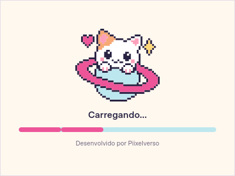

## Tela inicial

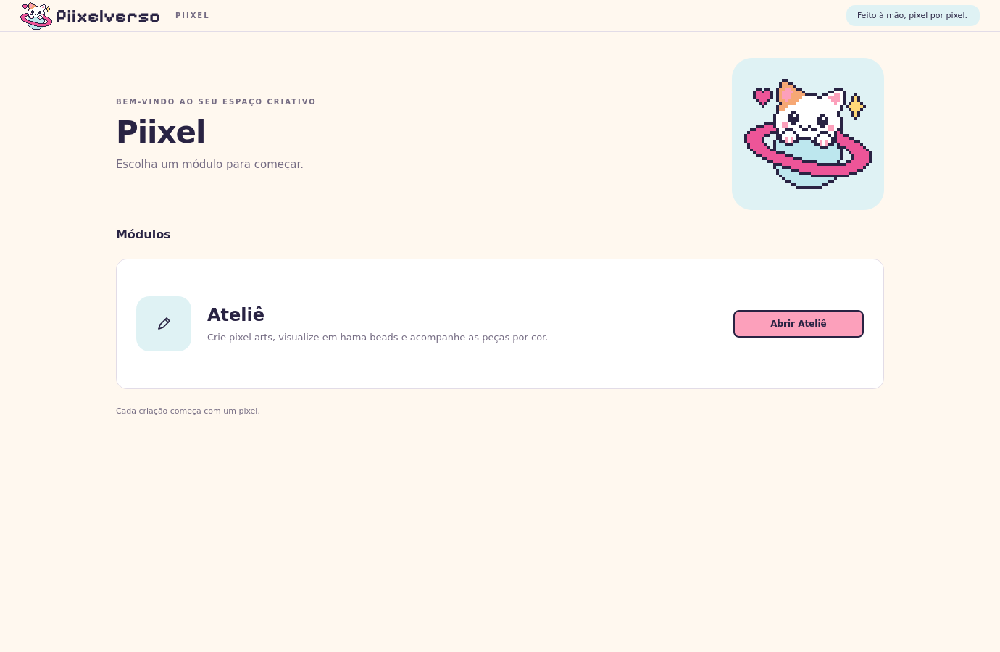

Escolha **Abrir Ateliê** para entrar no editor. Dentro dele, use **← Início**, **Arquivo → Tela inicial** ou **Alt+Home** para voltar. Ao retornar à tela inicial, o desenho, o arquivo aberto, o histórico, as cores e a visualização ficam preservados durante a sessão. Use **Continuar no Ateliê** para retomar.

Voltar ao início não salva nem descarta o desenho. Para conservar o trabalho depois de fechar o aplicativo, salve o arquivo `.pii`. Ao fechar o Piixel, a confirmação de alterações não salvas continua funcionando, inclusive na tela inicial.

À direita, **Últimos arquivos modificados** reúne os 20 designs abertos ou salvos mais recentes pela data de modificação do arquivo. Cada item mostra o nome do arquivo, uma miniatura e o caminho. Clique no item ou pressione Enter para abri-lo no Ateliê. A lista continua disponível ao reiniciar o Piixel e é atualizada ao voltar ao início.

Se o arquivo tiver sido movido ou apagado, a miniatura e o caminho anteriores permanecem na lista, e o programa informa: **Arquivo não encontrado. Verifique se o arquivo foi movido ou apagado.** O desenho que já estiver aberto continua preservado. Para localizar um arquivo movido, entre no Ateliê e use **Arquivo → Abrir** com o novo caminho.

Ao abrir um módulo pela primeira vez, uma pequena indicação **Carregando…**, com rodinha animada e o nome da página, aparece sobre a interface. A animação continua durante a preparação da página e desaparece quando ela é exibida, sem uma espera mínima. As páginas já abertas são reutilizadas. Ao voltar ao início, a atualização dos arquivos recentes também recebe essa indicação.

No Piixelfone, ações como abrir conversas, enviar mensagens ou arquivos e regenerar o número mostram o mesmo indicador dentro do módulo. Você pode voltar ao início enquanto a tarefa termina. A sincronização automática em segundo plano permanece discreta, sem cobrir a conversa. Diálogos de confirmação e mensagens de erro continuam acessíveis.

## Recursos do Ateliê

- Grade de 1 a 128 quadradinhos em cada dimensão.
- Redimensionamento da prancheta entre 10 e 128 células por eixo, preservando as peças e o histórico.
- Lápis, balde de tinta, borracha e conta-gotas para capturar cores já usadas.
- Linha reta, retângulo e elipse, com prévia, cancelamento e preenchimento opcional das formas.
- Seleção retangular com copiar, recortar, colar e mover, integrada ao histórico.
- Substituição de uma cor em todo o desenho, com prévia da quantidade de peças afetadas.
- Paleta inicial e cores personalizadas da sessão, com opção de salvar cores nomeadas para próximas sessões.
- Bead transparente na paleta padrão, distinta de branco e de uma célula vazia.
- Nove cores recentes com atalhos de 1 a 9 e amostras numeradas na paleta.
- Contagem por cor e total de peças; espaços vazios não entram na contagem.
- Desfazer, refazer e zoom da grade.
- Exibição em quadradinhos ou em rosquinhas estilo hama beads.
- Menus Arquivo, Editar e Exibir e uma única linha compacta de ferramentas, com atalhos de teclado.
- Salvamento e leitura no formato binário `.pii`, preservando dimensões, nome e cores.
- Exportação de PNG em quadradinhos ou rosquinhas, com grade opcional e medidas em milímetros.
- Configuração persistente do tamanho de cada peça, com padrão de 5 mm.

A contagem é a base para controlar materiais e calcular preços. Esta versão ainda não mantém um cadastro de estoque, custos, margens ou preços de venda.

## Piixelfone

Abra **Piixelfone** na tela inicial. No primeiro acesso, o aplicativo pede a chave pública de conexão e orienta a contatar o administrador do sistema. A URL do projeto já vem preenchida; a chave pública é salva neste computador. Use somente a chave **Publishable** ou **anon public**, nunca uma chave administrativa.

O administrador precisa preparar o projeto Supabase uma vez, seguindo [a instalação do servidor](docs/PIIXELFONE_SERVIDOR.md). Apenas preencher a chave não instala as tabelas nem habilita a autenticação. O Ateliê continua disponível sem configurar o chat.

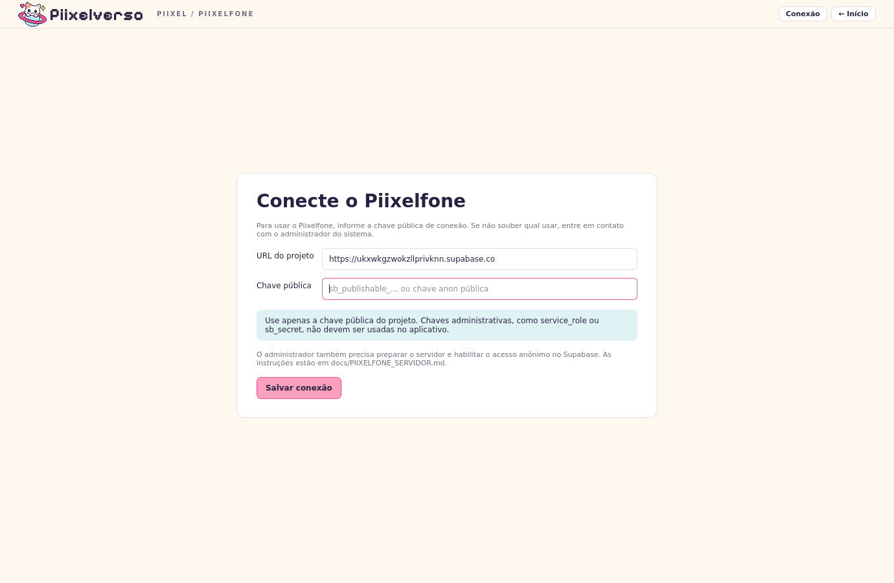

Depois de salvar a conexão, crie uma **senha local com pelo menos oito caracteres**. Ela protege suas chaves e conversas neste computador e não é enviada ao servidor. Ao reabrir o aplicativo, desbloqueie o Piixelfone com essa senha. Seu número tem seis dígitos, como **584 093**.

1. Digite o número da outra pessoa em **Adicionar contato** e envie o convite.
2. A outra pessoa aceita a solicitação na própria tela. Só então a conversa fica disponível.
3. Use **Verificar contato** para conferir os códigos das chaves por ligação ou pessoalmente. O código da sua própria chave aparece nos detalhes do diálogo. Essa conferência autentica o primeiro contato; mudanças posteriores de chave são bloqueadas.
4. Escreva até **150 caracteres** e clique em **Enviar**, ou pressione **Ctrl+Enter**. Use **Anexar .pii** para compartilhar um design válido.
5. Para guardar um anexo recebido, selecione a mensagem e use **Salvar arquivo .pii**, escolhendo onde gravar.

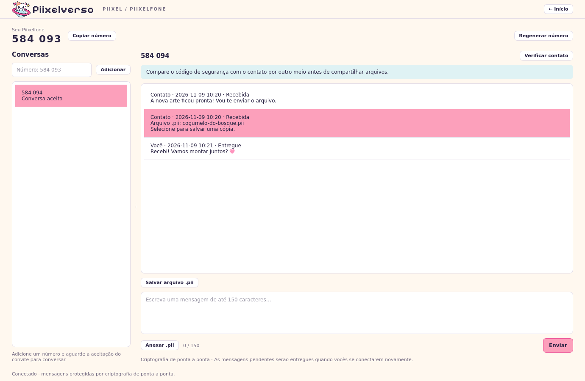

O histórico e a fila de saída ficam cifrados no computador. As mensagens mostram **Na fila**, **Enviada** ou **Entregue**. Se você estiver sem conexão, o envio aguarda localmente; se o destinatário estiver offline, o servidor guarda o envelope cifrado até recebê-lo. A confirmação de entrega ocorre depois da gravação local no destinatário. Novas tentativas não duplicam mensagens. Anexos são validados antes do envio e após a decifragem.

O botão **Regenerar número** pede confirmação. O número antigo deixa de aceitar novos convites e não será atribuído a outra pessoa. Contatos, conversas, mensagens pendentes e chaves permanecem vinculados à mesma identidade.

A sincronização consulta o servidor a cada cinco segundos enquanto o Piixel estiver aberto e o Piixelfone desbloqueado, inclusive ao voltar ao Ateliê. Ao fechar o programa, a fila já enviada permanece no servidor; as mensagens chegam quando o módulo for desbloqueado novamente. Não é necessário instalar um serviço de sistema.

A criptografia usa a biblioteca libsodium, por meio do PyNaCl. O servidor vê remetente, destinatário, horários e tamanho dos envelopes; não recebe o texto, o nome ou o conteúdo dos anexos em claro. Esta versão usa chaves estáticas e não oferece sigilo futuro (*forward secrecy*). O protocolo e as limitações estão descritos no [guia do servidor](docs/PIIXELFONE_SERVIDOR.md). As capturas de conversa usam dois clientes locais de teste, com criptografia real e transporte simulado.

Faça backup da pasta de dados `piixelfone` com o aplicativo fechado e guarde sua senha. Sem o arquivo `identity.vault` original e a senha, as chaves e o histórico não podem ser recuperados. O Supabase não mantém uma cópia legível das conversas. Não compartilhe nem versione essa pasta. O caminho é a pasta `piixelfone` ao lado de `preferences.json`, no diretório de dados do usuário; `PIIXEL_DATA_DIR` permite definir outro diretório.

## Identidade visual

A interface usa o kit de identidade visual v3 do Piixelverso: símbolo oficial do gatinho, logotipo em Pixelify Sans, textos em DejaVu Sans, fundo creme, azul-claro, rosa e contornos em tinta roxa. A frase de apoio é **Feito à mão, pixel por pixel.**

O símbolo e o logotipo vetoriais preservam as formas, cores e transparências do kit. As fontes de apoio e suas licenças acompanham o aplicativo, sem precisar instalá-las no sistema. A barra de menus e ferramentas permanece compacta, com 44 px de altura. As cores dos desenhos continuam sendo escolhidas livremente.

Os recursos usados e suas origens estão documentados em [piixelverso/assets/brand/README.md](piixelverso/assets/brand/README.md).

## Baixar o projeto

[Baixar o código em ZIP para Windows e Linux](https://github.com/IHenriqueCSN/piixel/archive/refs/heads/main.zip).

Extraia o ZIP e abra a pasta `piixel-main`. O pacote contém o código-fonte e os iniciadores; para usá-lo, instale Python 3.11 ou superior. A geração de um executável sem depender de Python instalado está descrita ao final deste documento.

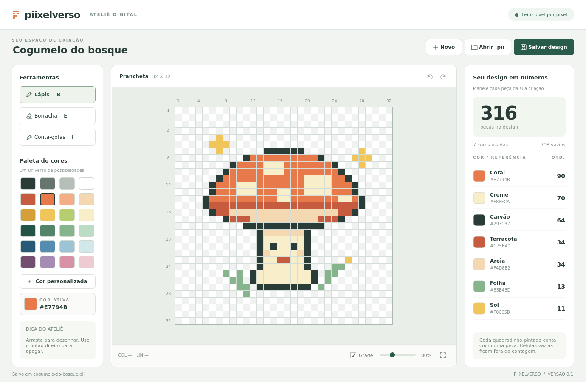

## Iniciar no Windows

Instale **Python 3.11 ou superior** pelo [site oficial](https://www.python.org/downloads/) e habilite a opção de adicionar Python ao `PATH`.

Com todos os arquivos do projeto na mesma pasta, abra `iniciar-windows.bat`. Na primeira execução, ele cria o ambiente `.venv` e instala os componentes Qt; essa etapa precisa de internet e ocorre antes de a tela de carregamento estar disponível. Nas próximas execuções, o aplicativo funciona localmente e exibe o carregamento logo no início.

Também é possível iniciar pelo terminal, dentro da pasta do projeto:

```powershell
py -3 -m venv .venv
.venv\Scripts\python.exe -m pip install -r requirements.txt
.venv\Scripts\python.exe -m piixelverso
```

## Iniciar no macOS ou Linux

Com Python 3.11 ou superior instalado, abra o terminal na pasta do projeto e execute:

```sh
sh iniciar-macos-linux.sh
```

Ou prepare o ambiente manualmente:

```sh
python3 -m venv .venv
.venv/bin/python -m pip install -r requirements.txt
.venv/bin/python -m piixelverso
```

O aplicativo precisa de uma sessão gráfica. No Linux, o Qt depende também das bibliotecas gráficas da distribuição. Se aparecer um erro de plataforma Qt ou `xcb`, confira a biblioteca citada na mensagem e instale o pacote correspondente pelo gerenciador do sistema.

Na primeira instalação pelo iniciador, a criação do ambiente e a instalação dos componentes Qt acontecem antes da tela de carregamento. Com os componentes já instalados, o iniciador evita carregar o Qt duas vezes e mostra a tela antes da inicialização da janela principal. O tempo até a primeira imagem depende da inicialização do Python, do Qt e do sistema gráfico.

## Usar o editor

Na tela inicial, entre no **Ateliê**. Em seguida:

1. Em **Arquivo → Novo**, crie um design e escolha a largura e a altura da grade.
2. Selecione uma cor na paleta ou use **Editar → Cor personalizada**.
3. Clique e arraste sobre os quadradinhos para desenhar. Use a borracha para remover peças.
4. Consulte a contagem por cor e o total de peças enquanto desenha.
5. Use **Arquivo → Salvar** para gravar o design `.pii` e **Arquivo → Abrir** para continuar depois.

O branco é uma cor e conta como peça quando aplicado. Um quadradinho vazio não
tem peça e fica fora da contagem; ele é diferente da bead **Transparente**, que
representa material físico e entra no estoque.

Selecione **Balde de tinta** na barra ou pressione **G** e clique em uma célula para preencher a área da mesma cor ligada pelas laterais. Células que se tocam somente pela diagonal ficam separadas. O balde também preenche áreas vazias e funciona nas duas exibições de peças. Cada clique forma uma única ação de desfazer.

Para trocar uma cor em todo o desenho, use **Editar → Substituir cor…** ou **Ctrl+H**. Os dois campos são listas suspensas: **Cor original** reúne as cores usadas no desenho, com a quantidade de peças; **Nova cor** oferece toda a paleta padrão e as cores personalizadas salvas, com nome, código hexadecimal e amostra da cor. Para criar outra cor, selecione **Escolher cor personalizada…** no final da lista. Se cancelar o seletor, a escolha anterior é preservada. O diálogo mostra quantas peças serão alteradas antes de confirmar. A troca inclui regiões separadas e pode ser desfeita em uma única ação. A contagem por cor é atualizada, mantendo o total de peças. Uma nova cor de destino entra na paleta da sessão; use a opção de salvar cor se quiser guardá-la para próximas sessões.

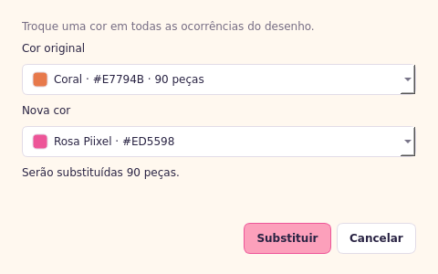

Em **Exibir → Peças**, alterne entre **Quadradinhos** e **Rosquinhas (hama beads)**. As rosquinhas têm um furo central e continuam permitindo desenhar, apagar e capturar cores em toda a célula. Essa opção muda apenas a exibição: as cores, as quantidades e os arquivos `.pii` são os mesmos. A escolha vale durante a sessão e continua ativa ao abrir ou criar outro design.

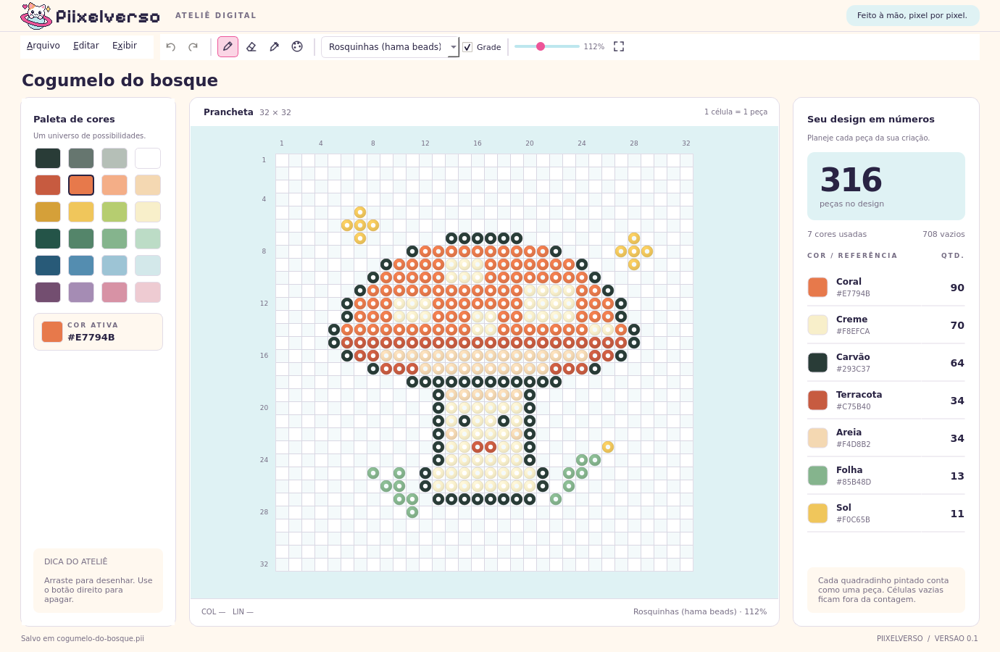

Clique no nome para renomear o design. A lista de cores à direita também permite selecionar uma cor já usada. Abra `examples/cogumelo-do-bosque.pii` para experimentar o editor com um desenho pronto.

## Desenhar formas geométricas

Escolha **Editar → Formas → Linha reta**, **Retângulo** ou **Elipse**. As mesmas ferramentas estão na seta do botão de formas da barra compacta; a parte principal do botão volta à última forma utilizada.

Selecione uma cor, clique no ponto inicial e arraste até a extremidade desejada. A prévia acompanha o mouse sem alterar o desenho ou a contagem. **Solte o mouse para confirmar** ou pressione **Esc** durante o arraste para cancelar. Cada forma confirmada corresponde a uma única ação de **Desfazer**.

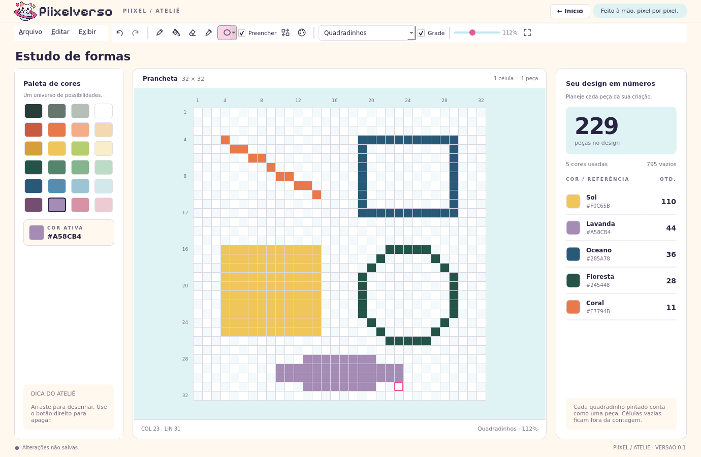

Retângulos e elipses começam com apenas o contorno. Marque **Preencher** na barra, ou **Editar → Formas → Preencher formas**, para usar a cor ativa também no interior. A opção fica disponível ao selecionar retângulo ou elipse. Para desenhar quadrados ou círculos, use a mesma quantidade de células na largura e na altura.

Os atalhos são **L** para linha, **R** para retângulo e **O** para elipse. As formas funcionam em quadradinhos e rosquinhas e respeitam os limites da prancheta. O botão direito continua apagando livremente. Ao trocar de ferramenta, salvar ou voltar ao início durante um arraste, a forma atual é concluída.

## Selecionar, copiar, recortar e colar

Escolha **Seleção** na barra, em **Editar → Seleção**, ou pressione **S**. Arraste
entre duas células para delimitar uma região. O contorno rosa mostra a área ativa;
pressione **Esc** ou clique com o botão direito para removê-lo sem alterar o
desenho.

Use **Ctrl+C** para copiar, **Ctrl+X** para recortar e **Ctrl+V** para colar. A
cópia preserva todas as células do retângulo, inclusive espaços vazios e beads
transparentes. Cada colagem aparece uma célula abaixo e à direita da seleção
anterior, enquanto houver espaço na prancheta, facilitando duplicar padrões. Para
mover uma região sem usar a área de transferência, arraste a partir de dentro da
seleção.

Recortar, colar e mover são ações únicas no histórico e podem ser desfeitas ou
refeitas. A seleção é limpa ao abrir, criar ou redimensionar um design. Os atalhos
de cópia atuam na prancheta quando ela está com foco; dentro do campo de nome,
continuam copiando, recortando e colando texto normalmente.

## Redimensionar a prancheta

No Ateliê, use **Editar → Redimensionar prancheta…** ou **Ctrl+Alt+C**. Defina a largura e a altura de forma independente, de **10 a 128 células** por dimensão. Por exemplo, é possível usar uma prancheta de **64 × 32**, **10 × 10** ou **128 × 128**.

Em **Posição do desenho**, escolha como manter as peças na nova área. O padrão é **Centro**; as outras opções permitem alinhar o desenho às bordas ou aos cantos. As peças mantêm seu tamanho e suas cores. Ampliar acrescenta células vazias; reduzir recorta apenas o que ficar fora da nova prancheta.

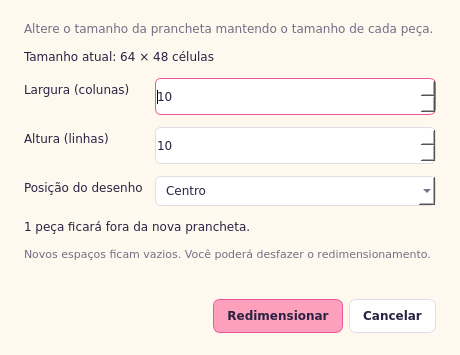

O diálogo mostra quantas peças seriam cortadas. Se houver peças fora dos novos limites, o aplicativo pede confirmação antes de aplicar a redução. **Desfazer** restaura as dimensões anteriores e as peças cortadas; **Refazer** reaplica a alteração. A ferramenta, a cor ativa, o zoom e a exibição em quadradinhos ou rosquinhas são preservados.

Salve o `.pii` para conservar as novas dimensões entre sessões. Designs antigos menores que 10 células continuam abrindo normalmente e podem ser ampliados pelo mesmo comando.

## Exportar como PNG

No Ateliê, use **Arquivo → Exportar como PNG…** ou **Ctrl+Shift+E**. Escolha **Quadradinhos** ou **Rosquinhas (hama beads)** e marque **Mostrar grade** se quiser incluir as linhas. A prévia mostra o resultado antes de gravar a imagem; essas escolhas valem para a exportação e preservam a visualização atual do editor.

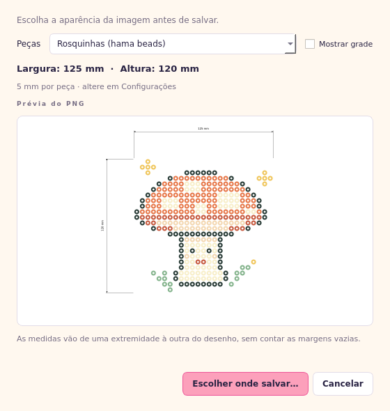

O PNG tem fundo branco e inclui setas de duas pontas e textos pretos: a largura fica acima do desenho e a altura à esquerda. As medidas vão da borda da peça mais à esquerda à borda da peça mais à direita e da peça mais alta à mais baixa. As margens vazias ficam fora da medida; os espaços entre as peças continuam contando para a distância entre as extremidades. Por exemplo, um desenho que ocupa **10 colunas × 8 linhas**, mesmo dentro de uma grade maior, mede **50 × 40 mm** com peças de **5 mm**. Peças brancas também entram no cálculo. Sem peças pintadas, as medidas são **0 × 0 mm**.

Clique em **Escolher onde salvar…** para selecionar a pasta e o nome do PNG. O arquivo registra também a densidade correspondente ao tamanho configurado da peça. Exportar mantém o caminho do design, o histórico e o estado de salvamento do `.pii`. Para continuar editando o trabalho em outra sessão, salve também o design pelo comando **Salvar**.

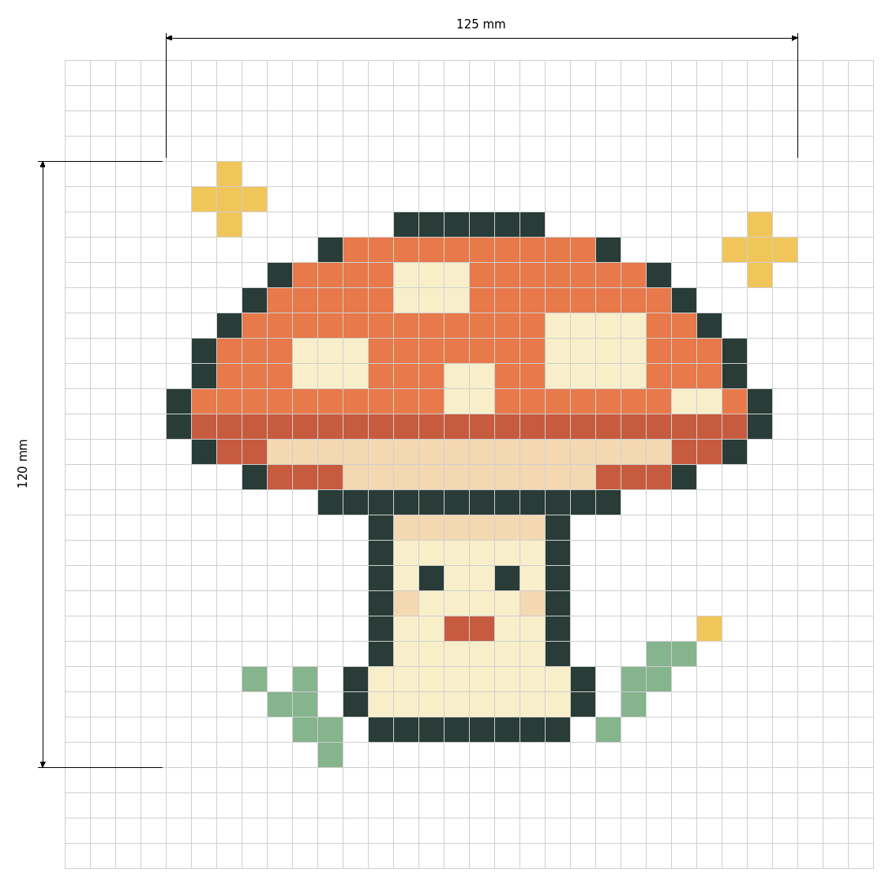

## Configurações

Abra **Configurações** na tela inicial, por **Arquivo → Configurações** no Ateliê ou com **Ctrl+,**. Em **Lado da peça**, informe o tamanho em milímetros e clique em **Salvar configurações**. O valor padrão é **5 mm**, como uma peça hama beads; são aceitos valores de **0,1 a 100 mm**, com até duas casas decimais.

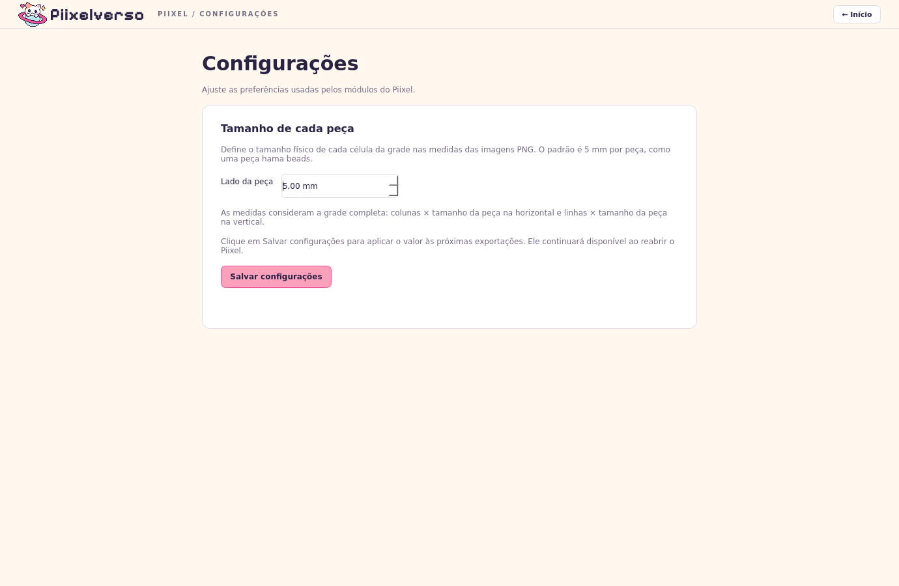

A configuração permanece entre sessões e é usada nas próximas exportações de PNG. Ela fica nas preferências locais do usuário. Voltar ao Ateliê preserva o desenho, as cores, o histórico e o arquivo aberto.

Na instalação do Windows, a mesma página mostra a versão atual e oferece
**Verificar atualizações**. O Piixel também faz uma verificação discreta em segundo
plano após abrir. Quando existe uma versão estável nova no GitHub Releases, o
programa oferece **Baixar e instalar** ou **Mais tarde**. O instalador só é aceito
quando seu SHA-256 corresponde ao arquivo publicado junto com a Release.

Depois do download, o fechamento normal permite salvar qualquer design pendente.
O instalador substitui a versão anterior e reabre o Piixel; preferências, cores,
conversas e arquivos `.pii` permanecem nos mesmos locais. A versão 0.1.0 ainda não
contém esse recurso e precisa receber a 0.2.0 manualmente uma vez.

## Cores recentes e atalhos

No Ateliê, a seção **Recentes · teclas 1–9**, acima da paleta, reúne até nove cores selecionadas nesta sessão. Pressione **1** a **9** para ativar a amostra com esse número, ou clique nela. Os números ficam legíveis tanto em cores claras quanto escuras; a cor ativa tem uma borda de destaque.

Escolher uma cor na paleta, nas peças do desenho, na contagem ou no seletor de cor personalizada a coloca no início da lista, sem duplicatas. Alternar pelos atalhos ou pelas próprias amostras recentes mantém a ordem: assim, você pode trocar entre **1** e **2** sem que as posições mudem. Posições ainda vazias ficam desabilitadas.

As cores recentes acompanham a sessão ao voltar ao início ou abrir outro design, e ficam sempre visíveis mesmo ao rolar a paleta. A lista recomeça ao fechar o programa; ela não salva cores personalizadas para próximas sessões. Para isso, use a opção explícita descrita abaixo. Os atalhos funcionam apenas no Ateliê e preservam a ferramenta atual. Ao digitar em campos ou diálogos, os números continuam sendo texto.

## Cores personalizadas

Em **Editar → Cor personalizada**, informe um hexadecimal `#RRGGBB` ou use **Escolher cor**. Ao confirmar **Adicionar cor**, ela aparece na paleta e fica disponível durante a sessão, inclusive ao voltar ao início e retornar ao Ateliê.

**Salvar para próximas sessões** começa desmarcado. Marque essa opção somente se quiser guardar a cor; nesse caso, também pode preencher um nome opcional. As cores salvas são restauradas ao iniciar outra sessão, e seus nomes aparecem na cor ativa, nas dicas da paleta e na contagem de peças.

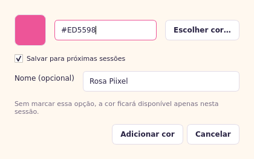

O botão direito sobre uma cor permite salvá-la, editar sua opção salva ou **Remover das cores salvas**. Remover essa opção mantém a cor disponível na sessão atual. Salvar um desenho `.pii` preserva as cores usadas nele, mas não transforma automaticamente suas cores em favoritas da paleta.

A lista de recentes, as cores que você escolheu guardar e o tamanho configurado das peças ficam nas preferências locais do usuário, separadas dos arquivos `.pii`.

## Beads transparentes

**Transparente** aparece entre as cores padrão e representa uma peça física sem
cor. Ela entra na contagem do estoque, nas medidas do design e nas cores recentes,
e funciona com lápis, balde, formas, conta-gotas e substituição de cor. A borracha
remove a peça e devolve a célula ao estado vazio.

Na prancheta e no PNG, a bead transparente recebe um preenchimento muito claro e
contorno azul para continuar visível. Em rosquinhas, o contorno acompanha o anel e
o furo permanece aparente. Ela não é gravada como cor personalizada porque já faz
parte da paleta padrão.

Arquivos que usam transparência são salvos como `.pii` versão 2. O Piixel continua
abrindo a versão 1 e ainda a utiliza para designs formados somente por cores
opacas. Branco, transparente e vazio permanecem distintos nos dois modos de
visualização.

## Menus e atalhos

A barra compacta no topo reúne menus tradicionais e ícones das ferramentas mais usadas. Os menus abrem somente quando acionados, deixando mais espaço para a prancheta:

- **Arquivo**: novo design, abrir, salvar, salvar como, exportar PNG, tela inicial e Configurações.
- **Editar**: desfazer/refazer, copiar/recortar/colar, redimensionar prancheta, seleção, lápis, balde de tinta, borracha, conta-gotas, formas geométricas, substituir cor e cor personalizada.
- **Exibir**: formato das peças, grade, zoom e ajustar à janela.

Os atalhos aparecem nos menus e nas dicas ao passar o mouse. Funcionam enquanto você desenha, sem precisar abrir os menus. No Windows e Linux:

| Comando | Atalho |
| --- | --- |
| Novo design | Ctrl+N |
| Abrir `.pii` | Ctrl+O |
| Salvar | Ctrl+S |
| Salvar como | Ctrl+Shift+S |
| Exportar como PNG | Ctrl+Shift+E |
| Redimensionar prancheta | Ctrl+Alt+C |
| Abrir Configurações | Ctrl+, |
| Desfazer | Ctrl+Z |
| Refazer | Ctrl+Y ou Ctrl+Shift+Z |
| Recortar seleção | Ctrl+X |
| Copiar seleção | Ctrl+C |
| Colar seleção | Ctrl+V |
| Ferramenta Seleção | S |
| Lápis | B |
| Balde de tinta | G |
| Borracha | E |
| Conta-gotas | I |
| Selecionar uma cor recente | 1 a 9 |
| Linha reta | L |
| Retângulo | R |
| Elipse | O |
| Cancelar forma ou limpar seleção | Esc |
| Substituir cor em todo o desenho | Ctrl+H |
| Menu Arquivo | Alt+A |
| Menu Editar | Alt+E |
| Menu Exibir | Alt+X |
| Voltar à tela inicial | Alt+Home |

O botão direito apaga sem trocar de ferramenta. Ao editar o nome do design, as letras são digitadas normalmente. Os atalhos de edição ficam ativos apenas no Ateliê. No macOS, os comandos usam os atalhos nativos indicados nos menus.

Também é possível abrir um arquivo diretamente no Ateliê pelo terminal:

```sh
python -m piixelverso examples/cogumelo-do-bosque.pii
```

## Arquivos `.pii`

O `.pii` é um formato próprio, binário e versionado. A versão 1 armazena cores RGB; a versão 2 acrescenta o material transparente. Ambas guardam cabeçalho, nome em UTF-8, paleta, índices das peças e um checksum CRC32 para detectar corrupção. O aplicativo valida o conteúdo ao abrir. Renomear uma imagem PNG ou outro arquivo para `.pii` não converte seu conteúdo.

Os arquivos ficam no local escolhido ao salvar. Faça cópias dos designs que quiser preservar em outro disco ou serviço de backup de sua preferência.

A especificação binária está em [docs/formato-pii.md](docs/formato-pii.md).

## Executar testes

Dentro do ambiente virtual do projeto:

```sh
python -m unittest discover -s tests
```

`unittest` faz parte do Python. Os testes de interface usam QtTest e executam em modo offscreen. A validação cobre desenho contínuo, preenchimento por área, substituição global de cor, contagem, histórico, salvar/reabrir, PNG com cotas, configurações persistentes, falhas de gravação, arquivos inválidos e uma paleta com 16.384 cores.

## Gerar um aplicativo para distribuição

O script de build usa PyInstaller e deve ser executado **no sistema de destino**: gere a versão Windows em Windows, macOS em macOS e Linux em Linux.

No ambiente virtual do projeto:

```sh
python -m pip install -r requirements-dev.txt
python scripts/build.py
```

O resultado fica em `dist/`. O build usa o modo `onedir`: distribua a pasta inteira gerada, com o executável e suas dependências. No Windows, a pasta `Piixel` contém `Piixel.exe`; no macOS, o PyInstaller pode gerar o pacote `.app`. Quem usar esse pacote não precisa instalar Python separadamente.

Para Windows 10/11 de 64 bits, o projeto também inclui um **instalador assistido** com atalho no menu Iniciar, opção de atalho na área de trabalho e desinstalação pelo Windows. Ele instala para o usuário atual, inclui Python e todas as dependências e preserva designs e dados pessoais ao desinstalar.

O [workflow Instalador Windows](https://github.com/IHenriqueCSN/piixel/actions/workflows/windows-installer.yml) gera o `.exe` em um computador Windows do GitHub. Abra uma execução concluída com sucesso e baixe **Artifacts → Piixel-Windows-x64**; o número do arquivo acompanha a versão do projeto.

Para distribuir uma atualização pelo próprio aplicativo, crie uma GitHub Release
estável com a tag da versão e anexe individualmente o instalador e o `.sha256`
gerados. O artifact do Actions não é usado diretamente pelos usuários porque tem
prazo de expiração. O procedimento e os nomes exigidos estão no
[guia do instalador Windows](docs/instalador-windows.md).

Para gerar o instalador localmente com Inno Setup 6, siga o [guia do instalador Windows](docs/instalador-windows.md). O workflow também verifica instalação, abertura de um design no aplicativo instalado e desinstalação sem remover os dados de teste. Assinatura digital e notarização não fazem parte desta geração.

## Organização

- `piixelverso/`: aplicativo, grade, contagem, modelo e leitura/gravação `.pii`.
- `piixelverso/app.py`: janela do Piixel e navegação, mantendo os módulos abertos durante a sessão.
- `piixelverso/startup.py`: entrada leve e encerramento do carregamento na abertura da janela principal.
- `piixelverso/splash.py`: tela de carregamento com animação independente da inicialização do editor.
- `piixelverso/modules.py`: cadastro dos módulos disponíveis: Ateliê, Piixelfone e Configurações.
- `piixelverso/piixelfone/`: interface do chat, casos de uso, transporte, cofre e histórico cifrado.
- `supabase/piixelfone.sql`: instalação das tabelas privadas, permissões e RPCs do chat.
- `piixelverso/home.py`: tela inicial.
- `piixelverso/atelier.py`: coordenação dos fluxos do Ateliê.
- `piixelverso/editor/`: sessão do documento, histórico, ações, paleta e construção da interface do editor.
- `piixelverso/ui/`: ícones e pequenos componentes visuais compartilhados.
- `piixelverso/module_api.py`: contrato comum de navegação, estado e fechamento dos módulos.
- `piixelverso/preferences.py`: preferências locais, arquivos recentes e cores salvas por escolha do usuário.
- `piixelverso/recents.py`: lista com miniaturas, nomes e caminhos dos arquivos recentes.
- `piixelverso/colors.py`: diálogo de cores personalizadas e opção de persistência.
- `piixelverso/operations.py`: cálculo dos preenchimentos e substituições sem alterar o desenho original.
- `piixelverso/replace.py`: escolha e prévia da substituição de cor.
- `piixelverso/png_export.py`: desenho e gravação atômica do PNG com medidas.
- `piixelverso/export_dialog.py`: escolha da aparência e prévia da imagem exportada.
- `piixelverso/settings.py`: módulo de configuração do tamanho das peças e acesso às atualizações.
- `piixelverso/update.py`: descoberta de Releases e download verificado do instalador.
- `piixelverso/update_ui.py`: verificação em segundo plano e fluxo visual da atualização.
- `piixelverso/resize.py`: cálculo do redimensionamento, posicionamento e recorte de peças.
- `piixelverso/resize_dialog.py`: escolha das dimensões e aviso de peças fora dos novos limites.
- `piixelverso/shapes.py`: geometria das linhas, retângulos e elipses, independente da interface.
- `tests/`: verificações do editor e do formato.
- `run_piixelverso.py`: entrada usada no empacotamento.
- `scripts/build.py`: geração do aplicativo pelo PyInstaller.
- `scripts/capture_behavior.py`: captura e comparação de telas, arquivos e atalhos antes/depois de uma alteração.
- `requirements.txt`: dependências para executar o editor.
- `requirements-dev.txt`: dependências para empacotar.

A separação de responsabilidades e o fluxo entre esses componentes estão documentados em [docs/arquitetura.md](docs/arquitetura.md).
