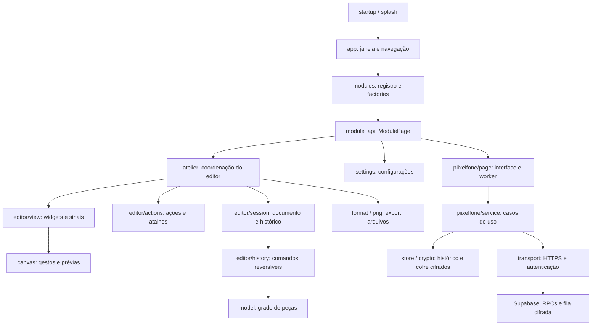

# Arquitetura do Piixel

O Piixel é uma aplicação Qt organizada por responsabilidade. O ponto de entrada continua em `startup.py`; a tela inicial, os módulos, os comandos e os formatos de arquivo mantêm seus fluxos existentes.



## Documento e regras de desenho

- `model.py` representa a grade, as cores e o nome do design.
- `operations.py`, `shapes.py` e `resize.py` calculam alterações sem depender de widgets Qt.
- `editor/session.py` mantém o documento aberto, seu caminho e o `QUndoStack`. Um salvamento só atualiza o caminho e a marca de documento salvo depois que a gravação termina com sucesso.
- `editor/history.py` aplica pixels, nomes e dimensões à sessão. Os comandos não conhecem janelas, campos de texto ou a construção da interface.

A identidade do documento é preservada durante redimensionamentos. Isso permite desfazer uma alteração de dimensões e depois desfazer comandos de pintura anteriores sem trocar seus índices de referência. Abrir outro arquivo substitui o documento e limpa o histórico, como antes.

## Apresentação e coordenação

- `editor/view.py` constrói os widgets e emite intenções como selecionar uma cor ou confirmar a edição do nome. Recebe as ações compartilhadas para os menus e a barra.
- `editor/actions.py` centraliza textos, ícones, atalhos e grupos exclusivos de ferramentas. Menus e botões usam as mesmas instâncias de `QAction`.
- `editor/palette.py` contém a paleta inicial, sem dependências de interface.
- `editor/recent_colors.py` apresenta nove amostras numeradas. A ordem das cores recentes pertence ao coordenador do Ateliê; selecionar um atalho mantém essa ordem, sem alterar o documento ou as preferências salvas.
- `editor/new_design_dialog.py` contém o diálogo de novo design.
- `ui/icons.py` e `ui/widgets.py` fornecem recursos visuais compartilhados, sem depender do Ateliê.
- `atelier.py` conecta a view, a sessão e os fluxos de interação, como diálogos de abrir, salvar, exportar e escolher cores. Ele mantém os acessos existentes a `design`, `file_path`, `history` e aos widgets usados pela interface e pelos testes.

Os construtores de comandos anteriormente importados de `atelier.py` continuam disponíveis como adaptadores para a sessão. O código novo usa os comandos de `editor/history.py` diretamente; esses comandos não dependem do coordenador ou dos widgets.

O canvas mantém o estado transitório dos gestos. A pintura livre continua atualizando os pixels durante o arraste; as formas geométricas continuam usando uma prévia separada até a confirmação. Ao concluir um gesto, o canvas informa os valores anteriores e posteriores, e a sessão registra o comando reversível. As notificações da sessão atualizam a apresentação.

## Módulos

`modules.py` reúne os metadados e as factories. As implementações são importadas quando o módulo é solicitado. A janela usa `ModulePage`, definido em `module_api.py`, em vez de acessar o canvas ou o histórico de um módulo concreto.

O contrato contém:

- `set_active`, `prepare_navigation` e `focus_default` para ativação e navegação.
- `home_state` para informar opcionalmente o nome e as alterações pendentes exibidos no início.
- `attach_navigation` para receber as ações globais de início e configurações.
- `confirm_close` para autorizar o fechamento, inclusive quando o módulo está oculto.
- `shutdown` para encerrar o trabalho em segundo plano depois que todos os módulos aceitarem o fechamento.
- `load_path` e o sinal `document_accessed` para módulos que abrem documentos.

Para acrescentar um módulo, implemente esse contrato e registre sua factory junto aos metadados. A rota de arquivos `.pii` continua direcionada ao Ateliê.

## Persistência e compatibilidade

O Piixelfone fica isolado em `piixelfone/`. `page.py` constrói a interface e envia operações para uma única fila em uma thread de trabalho; um timer solicita sincronização sem sobrepor operações. Navegar para outro módulo mantém a sessão conectada. O encerramento interrompe novas tarefas e não espera por chamadas de rede na thread gráfica.

`service.py` coordena identidade, contatos, criptografia, envio, recebimento e confirmação de entrega, sem depender do Qt. `transport.py` usa HTTPS, bloqueia redirecionamentos, limita tamanhos e apresenta erros sem incluir tokens nem respostas do servidor. `config.py` aceita apenas a chave pública; credenciais administrativas são recusadas.

`crypto.py` usa Box da libsodium para os envelopes e SecretBox para o cofre e os registros locais. Argon2id deriva a chave do cofre a partir da senha local. `store.py` mantém contatos e registros cifrados no SQLite, com conexões por operação e proteção contra troca de chave. Cada envelope vincula criptograficamente o UUID da mensagem, remetente e destinatário. Retransmissões preservam o mesmo UUID e ciphertext; o destinatário grava antes de confirmar ao servidor.

`supabase/piixelfone.sql` mantém tabelas em schema privado, com RLS e sem acesso direto por clientes. RPCs autorizam cada operação pelo JWT autenticado. O conteúdo cifrado permanece até o destinatário confirmar ou recusar; depois disso fica apenas o estado e o hash para preservar a idempotência. Números antigos ficam reservados permanentemente. O [guia de instalação](PIIXELFONE_SERVIDOR.md) descreve a implantação e as limitações criptográficas.

`format.py` continua responsável pelo `.pii` versionado e pela gravação atômica. `preferences.py` continua guardando arquivos recentes, cores salvas e tamanho das peças. `png_export.py` continua renderizando e gravando o PNG com as mesmas medidas, cores e opções.

Esta reorganização não altera formatos, chaves das preferências, limites das pranchetas, mensagens, menus ou atalhos. Os testes anteriores permanecem nos mesmos arquivos; os novos testes verificam a sessão, as ações e o contrato dos módulos isoladamente.

## Comparação antes/depois

No mesmo ambiente, versão do Qt e sistema gráfico, capture uma referência antes da alteração:

```sh
python scripts/capture_behavior.py /tmp/piixel-before
```

Depois da alteração, compare em outra pasta:

```sh
python scripts/capture_behavior.py /tmp/piixel-after --compare /tmp/piixel-before
```

O script usa preferências temporárias e compara 17 artefatos: telas em dois tamanhos, diálogos, exportações PNG, design `.pii`, preferências e definições das ações. A pasta de dados normal do usuário não é usada por essa verificação.
